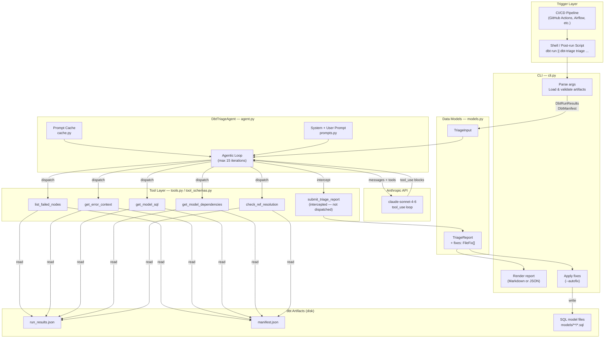
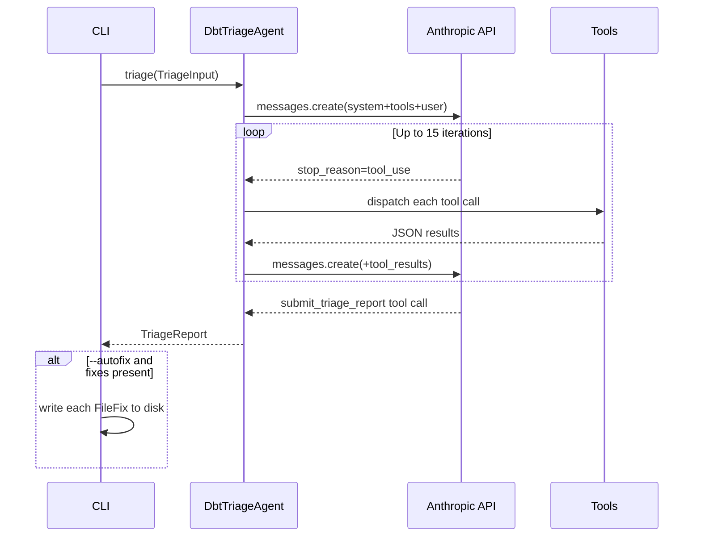
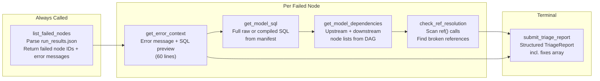
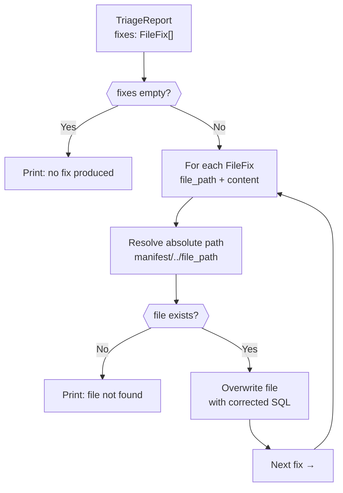

# Architecture

## System Overview

---

## Agentic Loop

---

## Tool Responsibilities

---

## Autofix — Multi-File Flow

---

## Component Map

| File | Responsibility |
|------|---------------|
| `cli.py` | Entry point, artifact loading, report rendering, autofix file writes |
| `agent.py` | Agentic loop, tool dispatch, `submit_triage_report` interception |
| `tools.py` | Pure functions reading manifest/run_results from disk |
| `tool_schemas.py` | Anthropic JSON tool schemas passed to `messages.create()` |
| `models.py` | Pydantic models for dbt artifacts (`DbtManifest`, `DbtRunResults`) and agent I/O (`TriageInput`, `TriageReport`, `FileFix`) |
| `prompts.py` | Static system prompt (`AGENT_INSTRUCTIONS`) and dynamic user message builder |
| `cache.py` | Wraps system prompt with `cache_control: ephemeral` for prompt caching |
